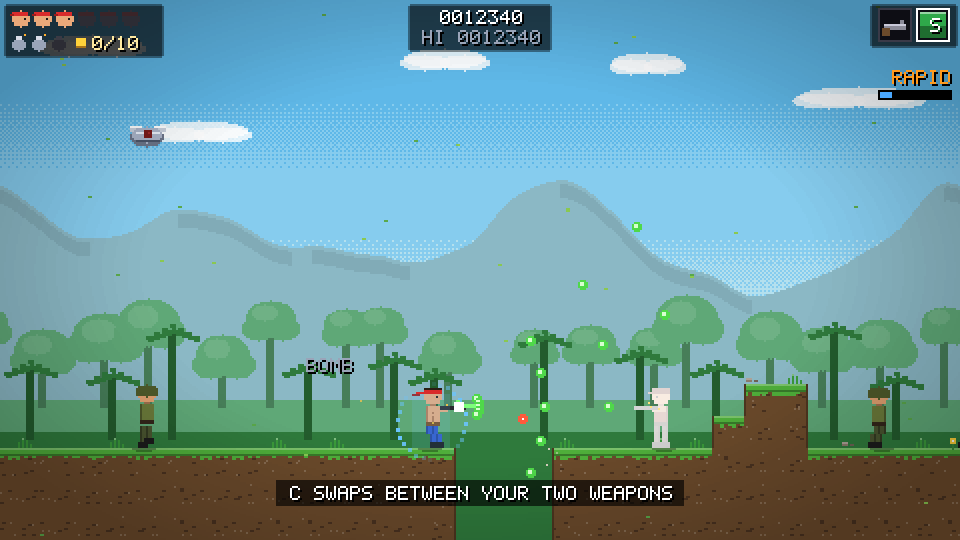

# Epoch Strike

A single-player 2D run-and-gun in the spirit of *Contra*. A time rift has opened and an alien warlord is seeding his army
across every era of history. One soldier chases him through **20 levels, from the Cretaceous to the end of time**, each
ending in a boss that guards the next rift.

Plain HTML5 canvas and JavaScript. **No engine, no dependencies, no build step, no downloaded assets**: the graphics,
sound effects and music are all generated by the code (see [CREDITS.md](CREDITS.md)). The game ships with nothing to install; Playwright is a dev-only dependency for the browser tests.



## Play

* **Online:** push the repository to GitHub, then in *Settings -> Pages* choose *Source: GitHub Actions*. The included
  workflow publishes the game on every push to `main` (after the tests pass).
* **Locally:** `npm start`, then open <http://localhost:8080>. Any static file server works too (the game is
  `index.html`, `style.css` and `src/`). It needs a browser with ES modules and Web Audio, which is any current one.

## Controls

| Action | Keyboard | Gamepad | Touch |
| --- | --- | --- | --- |
| Move / aim (8 directions) | Arrows or WASD | D-pad or left stick | On-screen stick |
| Jump (hold for a higher jump) | Z or Space | A | JUMP |
| Fire (hold) | X or J | X, RT or RB | FIRE |
| Switch weapon | C or K | Y or LB | SWAP |
| Smart bomb | V or L | B or LT | BOMB |
| Pause | Esc or P | Start | II |
| Drop through a platform | Down + Jump | Down + A | |
| Fullscreen / mute | F / M | | |

The game pauses by itself when you leave the window, and the touch controls appear on the first touch.

## How it plays

* **Lives.** You start with 3 (Easy: 5) and can hold at most 6. Any hit kills; you respawn on the spot with a moment of
  invincibility and your gun reverts to the rifle. A life comes from: **10 medals**, a **hidden 1UP** (one per group of
  four eras), **20,000 points and then every 50,000**, and **beating a boss without dying** on that level. A life earned at
  the cap pays 5,000 points instead. With no lives left you can Continue up to 3 times.
* **Weapons.** Flying capsules drop **M**achine gun, **S**pread, **L**aser, **F**lame and **H**oming, plus
  **R**apid fire and a **B**arrier. You carry two guns and swap between them. Each group of four eras has its own **E**ra
  weapon in a capsule: the Fire Spear (levels 1-4), Ballista Bolt (5-8), Crossbow Volley (9-12), Tesla Coil (13-16) and
  Plasma Cannon (17-20). Smart bombs clear the screen.
* **Rides.** A rideable tank and a hoverbike turn up in the later eras; each soaks up hits.
* **Bosses.** Every boss has two or three phases, telegraphs each attack for at least 0.6 seconds and has a weak point that
  is only open at certain moments.
* **Score.** Kills chain into combos (up to x2), medals are 500 each, and each cleared level pays 2,000 per life left plus
  5,000 for a clean run. Clearing the game pays 50,000, no continues 25,000 more, and a game without a single death 100,000.
* **Options.** SFX and music volume, difficulty (Easy: 5 lives and slower bullets; Hard: faster bullets and no medals),
  screen shake, effects quality (High or Low, for slow devices), the touch controls (Auto, On, Off) and three display
  choices: **Flashes** (Reduced softens the smart-bomb white-out, hit flashes and boss blinks and halves the shake), **HUD
  size** (Large doubles the corner clusters) and a **CRT filter** (scanlines). Your progress, high scores and options are
  saved in the browser.

## The 20 eras

| # | Level | Era | Boss |
| --- | --- | --- | --- |
| 1 | Dino Jungle | Cretaceous | REX-7 |
| 2 | Volcano Run | Cretaceous | Magma Golem |
| 3 | Frozen Glacier | Ice Age | Mammoth Walker |
| 4 | Cave Tribes | Stone Age | Cave Bear Hive |
| 5 | Pyramid of Ra | Ancient Egypt | Animated Sphinx |
| 6 | Siege of Troy | Ancient Greece | Bronze Colossus |
| 7 | The Colosseum | Ancient Rome | Chariot Champion |
| 8 | The Great Wall | Imperial China | Dragon Kite Fortress |
| 9 | Fjord Raid | Viking Age | The Kraken |
| 10 | Castle Siege | Medieval Europe | Siege Tower Titan |
| 11 | Shadow Castle | Feudal Japan | Oni Warlord |
| 12 | Pirate Armada | Age of Sail | Ghost Galleon |
| 13 | Desert Train | The Wild West | Armored Locomotive |
| 14 | Steam Factory | The Industrial Age | Iron Furnace Engine |
| 15 | Trench Line | The First World War | War Zeppelin |
| 16 | Coastal Assault | The Second World War | Super-Heavy Tank |
| 17 | Arctic Missile Base | The Cold War | Missile Silo Mech |
| 18 | Neon City | The Modern Age | Gunship Helicopter |
| 19 | Cyber Megacity | The Cyber Age | AI Core Hydra |
| 20 | Warlord Citadel | The End of Time | Echoes of three old bosses, then the Rift Warlord |

Every level adds something new: rising lava, searchlights and an alarm, gravity halls, a hoverbike skyway, laser walls,
swinging ropes, a war chariot and more. Levels unlock as you clear them and can be replayed from the level select.

## Develop

```sh
npm start          # static server on http://localhost:8080
npm test           # the whole suite (node --test, about 10 seconds, no packages to install)
npm run coverage   # the same suite with a coverage floor on src/ (what CI runs)
npm run mutate     # mutation testing of the pure modules (Stryker; minutes, run by hand)
npm run e2e        # the browser suite (Playwright: needs `npm ci` then `npx playwright install`)
```

| Script | What it does |
| --- | --- |
| `npm run shots` | menu, play, pause, results... screenshots into `docs/screenshots` |
| `npm run themeshots` | one frame per era theme |
| `npm run levelshots <n>` | a bot plays level *n* and photographs it |
| `npm run bossshots <n>` | a bot fights boss *n* and photographs each attack and phase |
| `npm run musicwav [track]` | render the soundtrack to WAV files so you can listen to it |
| `npm run perf` | simulation time and canvas-call counts per level and boss |
| `npm run economy` | the lives economy of the whole game, level by level |

The code is organised in layers (engine, game simulation, art, scenes) and every registry (enemies, bosses, levels, music
tracks, weapons) has one place to add to. Read [docs/ARCHITECTURE.md](docs/ARCHITECTURE.md) before changing anything. The
git history follows a 16-week sprint plan, about one commit per week, so `git log` reads as the story of the build.

```
index.html, style.css     the page, with the on-screen touch controls
src/engine/               input, audio, music synth, bitmap font, canvas helpers, RNG
src/game/                 the simulation: world, player, enemies, bosses, weapons, levels, solver, score, save
src/game/art/             every sprite and backdrop, drawn with rectangles
src/scenes/               title, menu, play, results, ending, credits, options...
tests/                    node --test (unit / integration / e2e), running the real game against a software canvas
tools/                    dev server, screenshot / WAV / profiling tools, the test bots
```

Testing is unusually thorough because there is no browser in the loop: a software canvas renders real frames in Node, a
solver proves each level can be finished, and bots cross every level and fight every boss in god mode.

## Licence

MIT, see [LICENSE](LICENSE).
